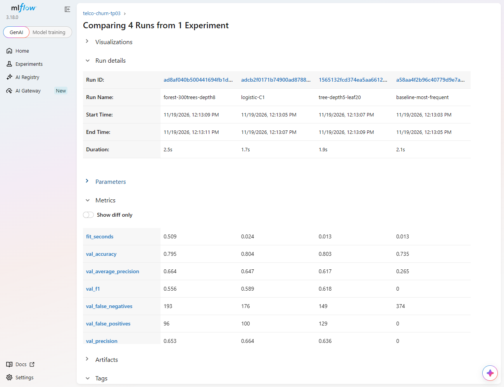
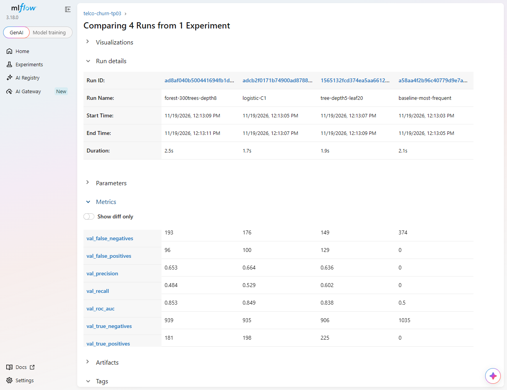
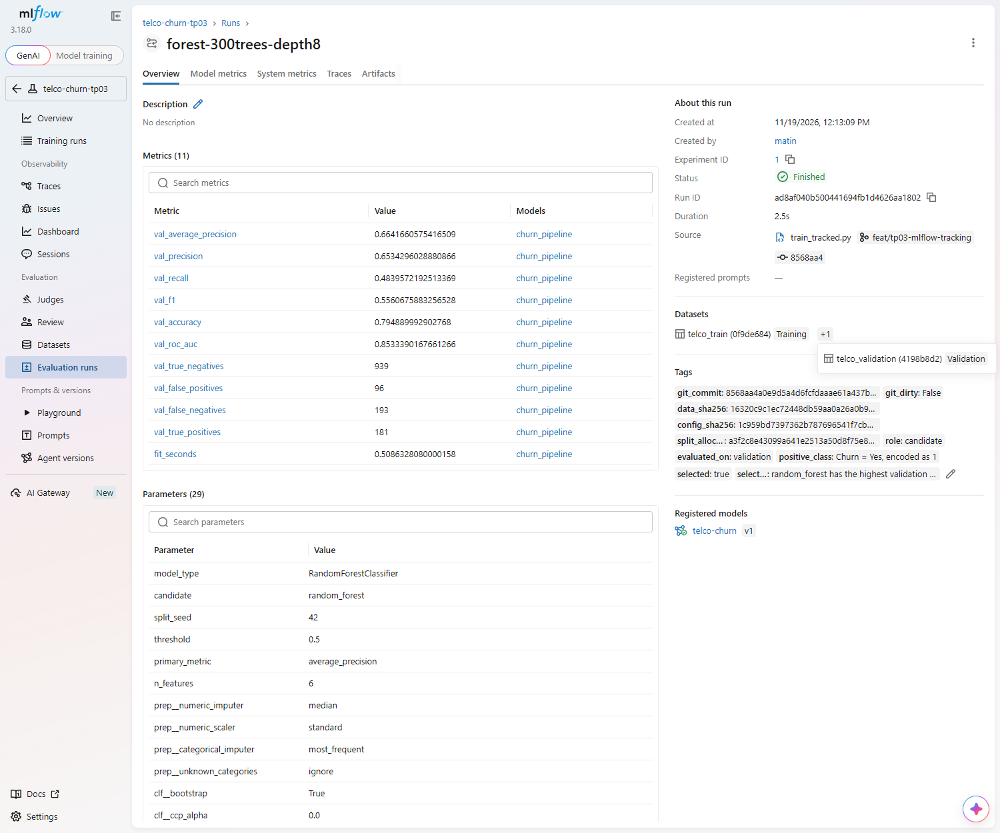
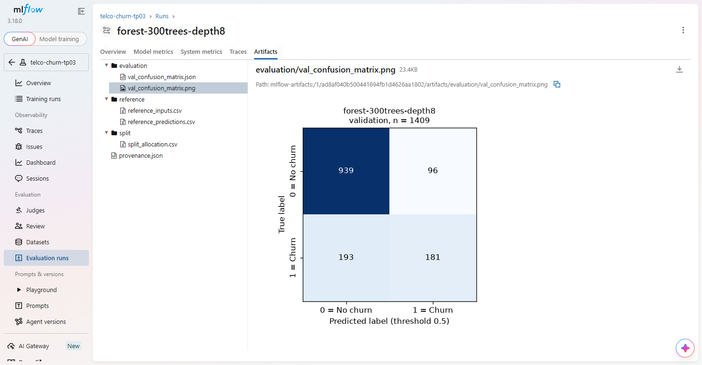
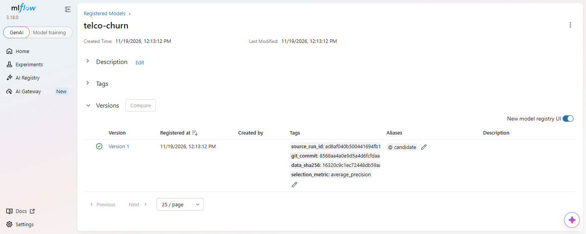
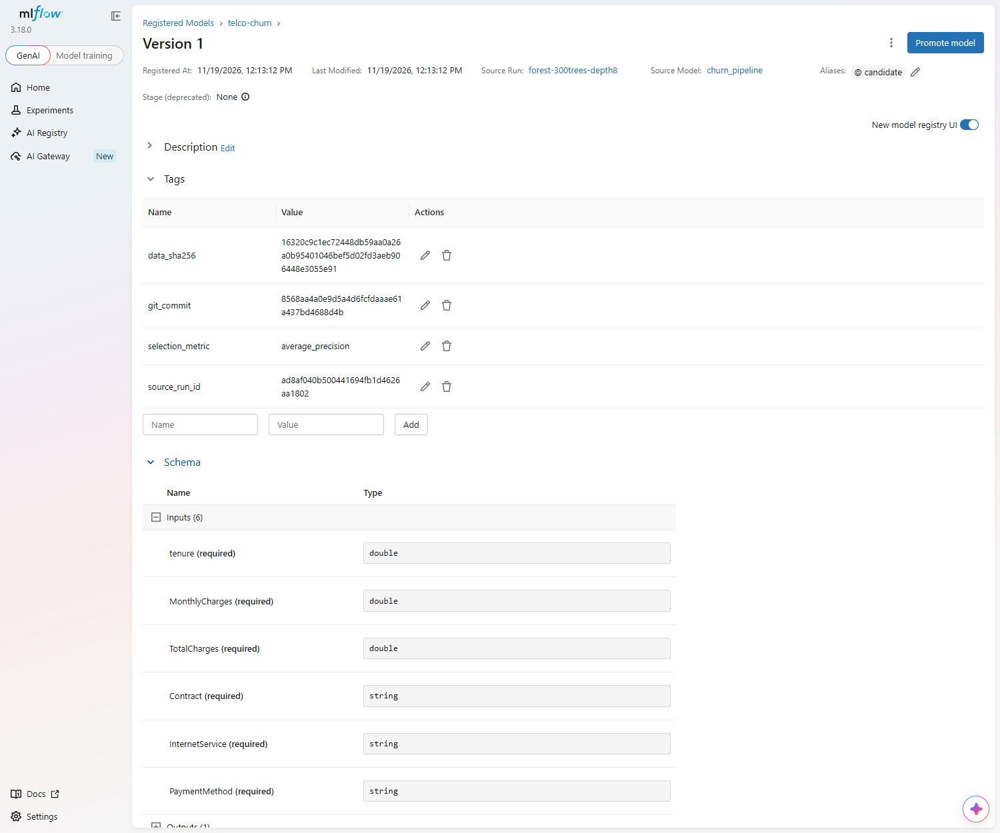

# TP03 summary: track, compare and recover the churn model with MLflow

All values below come from one tracked execution on 2026-11-19, MLflow
3.18.0, tracking server at `http://127.0.0.1:5000` started from the project
root (SQLite backend `mlflow.db`, artifact store `mlartifacts/`). Raw logs
are in [`evidence/tp03/`](../evidence/tp03/); machine-readable records are
[`tp03_runs.json`](tp03_runs.json),
[`tp03_run_comparison.csv`](tp03_run_comparison.csv) (exported with
`mlflow.search_runs`) and [`tp03_reload_check.json`](tp03_reload_check.json).

Nothing about the modelling changed from TP02: same six features, same
customer allocation, same pipeline builder, same evaluator, same selection
rule, test set never evaluated.

## 1. Comparison of the candidate runs

Experiment `telco-churn-tp03` (ID `1`), four finished runs: three learned
candidates and the majority baseline for context. All share the split seed
(42), the threshold (0.5), the preprocessing and the validation population
(1 409 customers); only the classifier differs.



Same page, metrics table scrolled to show recall, ROC AUC and the confusion
counts:



Parameters that differ between runs (hyperparameters read back from the
fitted estimators): [`figures/tp03/01b_compare_runs_parameters.png`](figures/tp03/01b_compare_runs_parameters.png).

### Selection table

| Run ID | Candidate / changed setting | Validation AP | Validation recall | Validation F1 | Decision |
|---|---|---:|---:|---:|---|
| `a58aa4f2b96c40779d9e7ab76d0af26d` | `baseline-most-frequent`: `DummyClassifier(strategy="most_frequent")` | 0.2654 | 0.0000 | 0.0000 | Context only, not eligible |
| `adcb2f0171b74900ad878838af7122b4` | `logistic-C1`: `LogisticRegression(C=1.0, max_iter=1000)` | 0.6475 | 0.5294 | 0.5893 | Not selected (0.0167 below the best, outside the 0.01 tie tolerance) |
| `1565132fcd374ea5aa6612933f895edd` | `tree-depth5-leaf20`: `DecisionTreeClassifier(max_depth=5, min_samples_leaf=20)` | 0.6173 | 0.6016 | 0.6181 | Not selected |
| `ad8af040b500441694fb1d4626aa1802` | `forest-300trees-depth8`: `RandomForestClassifier(n_estimators=300, max_depth=8, min_samples_leaf=10)` | **0.6642** | 0.4840 | 0.5561 | **Selected** |

Validation precision at the same threshold: 0.0000, 0.6644, 0.6356 and
0.6534 respectively.

### Why the random forest

The primary metric was fixed in TP02, before any result: validation average
precision on positive-class probabilities, with a rule that candidates
within 0.01 of the best are tied and the simpler one wins. The random
forest has the highest validation AP (0.6642). Logistic regression is the
closest (0.6475), but the gap is 0.0167, which is outside the tolerance, so
the simplicity tie-break does not apply. Fit time does not change the
choice: 0.51 s for the forest against 0.02 s for logistic regression on
this machine. At threshold 0.5 the forest actually has the lowest recall
and F1 of the three; I did not switch to those metrics after seeing the
results, because AP measures the ranking of customers by risk and the 0.5
threshold is a convention that has not been tuned. This is one split of one
dataset: a 0.017 difference is a classroom result, not proof that the
forest is significantly better.

## 2. The selected run

Run `forest-300trees-depth8`, ID `ad8af040b500441694fb1d4626aa1802`. The
overview shows the validation metrics (each linked to the logged model
`churn_pipeline`), the parameters, the identity tags, and both dataset
records: `telco_train` (digest `0f9de684`, context `Training`) and
`telco_validation` (digest `4198b8d2`, context `Validation`).



Its artifacts: confusion matrix (PNG and JSON), `provenance.json`, the
customer allocation and the reference batch. In the matrix, rows are true
labels and columns are predicted labels, both in the order `[0, 1]` with
`0` = no churn and `1` = churn: TN 939, FP 96, FN 193, TP 181.



The logged model page links the model to its source run, to the validation
dataset the metrics were computed on and to the registered version:
[`figures/tp03/04_logged_model.png`](figures/tp03/04_logged_model.png).
A copy of the run's `provenance.json` is in
[`evidence/tp03/selected_run_provenance.json`](../evidence/tp03/selected_run_provenance.json).

## 3. Registry

Registered model `telco-churn`, version 1, alias `candidate`. Registration
and alias assignment were done through the API
(`mlflow.register_model` then `MlflowClient.set_registered_model_alias`),
in `telco_churn/registry.py`.



Version page with the source run, the tags and the stored input schema:



The input schema (inferred from the input example, three training rows) is
`tenure`, `MonthlyCharges`, `TotalCharges` as `double` and `Contract`,
`InternetService`, `PaymentMethod` as `string`. It describes the parsed,
**unencoded** columns the pipeline expects, without `Churn` or
`customerID`. It does not describe valid ranges or categories.

## 4. Identifiers

| Item | Value |
|---|---|
| Source run ID | `ad8af040b500441694fb1d4626aa1802` |
| Logged model URI | `models:/m-ec6ef3a1620249f4a3af72ba1ed40515` |
| Registered model and version | `telco-churn`, version `1` (`models:/telco-churn/1`) |
| Alias | `candidate` (`models:/telco-churn@candidate`) |
| Git commit of the training code | `8568aa4a0e9d5a4d6fcfdaaae61a437bd4688d4b`, working tree clean (`git_dirty = False`) |
| SHA-256 of the original CSV | `16320c9c1ec72448db59aa0a26a0b95401046bef5d02fd3aeb906448e3055e91` |
| SHA-256 of the customer allocation | `a3f2c8e43099a641e2513a50d8f75e86e0a7bfdcd36f9f1347b5a4e05917728d` (identical to TP02's `models/churn_pipeline/split_allocation.csv`) |
| MLflow dataset digests | `telco_train` `0f9de684`, `telco_validation` `4198b8d2` |

| Identifier | Question it answers |
|---|---|
| Run ID | Which execution produced the result? |
| Logged model URI | Which recorded model artifact should be loaded? |
| Registered name + version | Which version of the managed model `telco-churn` is it? |
| Alias `candidate` | Which version currently holds this named role? |

## 5. Fresh-process inference and prediction agreement

Commands, each a new terminal process, server running, no `fit`:

```sh
uv run python scripts/verify_registered.py
uv run python scripts/predict_registered.py --input evidence/tp02/example_new_customers.csv
```

Output ([`evidence/tp03/inference_output.txt`](../evidence/tp03/inference_output.txt)):

```text
$ uv run python scripts/verify_registered.py
Loaded models:/telco-churn@candidate -> telco-churn version 1
Source run: ad8af040b500441694fb1d4626aa1802; logged model: models:/m-ec6ef3a1620249f4a3af72ba1ed40515
  [ok] labels_absent_from_inputs
  [ok] same_customer_order
  [ok] probabilities_within_tolerance
  [ok] class_predictions_identical
  [ok] learned_statistics_unchanged_by_predict
  [ok] fit_disabled_during_inference
Max |probability difference| = 0 (tolerance 1e-12) over 10 records

$ uv run python scripts/predict_registered.py --input evidence/tp02/example_new_customers.csv
Loaded models:/telco-churn@candidate -> telco-churn version 1
customerID  churn_probability  churn_prediction
  NEW-0001           0.698899                 1
  NEW-0002           0.102803                 0
  NEW-0003           0.082097                 0
```

How agreement is checked: during training, before the pipeline is logged,
the in-memory pipeline predicts 10 raw validation customers (no labels) and
both the inputs and the predictions are logged as run artifacts
(`reference/`). The fresh process loads the pipeline through the alias,
replaces `fit`, `fit_transform` and `partial_fit` with a function that
raises, predicts the same 10 customers and compares: class predictions must
be identical and probabilities within `1e-12`. Result: maximum absolute
difference 0. The three new customers also get the same probabilities as
TP02's joblib artifact (`evidence/tp02/example_predictions.csv`), including
`NEW-0002`, whose blank `TotalCharges` goes through the same stateless
parsing and median imputation.

Why a new process is stronger evidence than predicting again in the training
session: in the training session the fitted object is still in memory, so
predicting again proves nothing about what was stored. A new process has
only the stored files, so it shows that the saved model is complete (it
contains the preprocessing, not only the classifier), that it can be
imported with the installed packages, and that nothing depends on variables
left over from training.

## 6. Restart observation

Full log: [`evidence/tp03/restart_observation.txt`](../evidence/tp03/restart_observation.txt).

| | Before stop (11:19:39 UTC) | After restart (11:20:03 UTC) |
|---|---|---|
| Server process | PID 2518 | PID 10624 (new process) |
| Experiment / finished runs | `telco-churn-tp03` / 4 | `telco-churn-tp03` / 4, same run IDs and metrics |
| Registry | `telco-churn` version 1, alias `candidate` → 1 | unchanged |
| `mlflow.db` | 1 089 536 bytes | still on disk while stopped, same size |
| `mlartifacts/` | 52 files | 52 files |
| Inference through the alias | agreement, max difference 0 | agreement, max difference 0 |

While the server was stopped the health check was refused, but the two
stores were untouched on disk. Restarting from the same project root with
the same command brought everything back: the server holds no state of its
own, it only serves what is in `mlflow.db` and `mlartifacts/`.

### What do the database and the artifact store each preserve?

- **`mlflow.db` (backend store)**: the experiment, the runs and their
  status, parameters, metrics, tags, dataset records (name, digest, schema,
  context), logged-model metadata, and the registry: the name `telco-churn`,
  its versions and the alias `candidate`.
- **`mlartifacts/` (artifact store)**: the files. The serialized pipeline
  (`model.pkl`), its `MLmodel` descriptor and environment files, the input
  example, the confusion matrices, `provenance.json`, the allocation CSV
  and the reference batch.

If the database survived but the model files were lost, I could still list
the runs, compare metrics and see that version 1 carries the alias, but
`load_model` would fail and the confusion matrices and provenance files
would be gone: I would know which model was chosen without being able to
use it. If only the model files survived, the pipeline would still be on
disk and loadable by file path, but nothing would say which run, parameters
and metrics it belongs to, and the name, version and alias would no longer
resolve.

### What must a colleague on another machine obtain separately?

A run ID, a `models:/` URI and `http://127.0.0.1:5000` only mean something
on my machine. A colleague needs:

1. both stores together (`mlflow.db` **and** `mlartifacts/`), or access to
   a shared tracking server, or an exported copy of the model directory;
2. this repository at commit `8568aa4`, because inference uses the
   project's input parsing (`telco_churn`);
3. the locked environment (`uv sync --locked`): the model is a pickle and
   needs compatible scikit-learn, NumPy and pandas versions;
4. the original CSV if they want to retrain or check the split
   (`uv run python scripts/download_data.py`): MLflow stores its SHA-256 and
   a dataset digest, not the data.

Setting up a shared server or an export is extra work that this TP does not
do.

## Answers to the questions in the brief

**If a colleague receives only `mlflow.db`, what else do they need to load
the pipeline?** The artifact store (`mlartifacts/`, which holds the model
files), a server or tracking URI pointing at both, and an environment with
compatible library versions plus this project's code.

**Experiment versus run. Is the browser page executing my training code?**
An experiment is a named group of runs that are meant to be compared (here
`telco-churn-tp03`). A run is one execution of training code, with its own
ID, parameters, metrics, tags and files. The browser executes nothing: the
training client (my Python process) runs the code and sends records to the
server, and the UI only displays what the server stored.

**Metric versus artifact.** A metric is a number stored in the database
under a key (for example `val_average_precision = 0.6642`), so it can be
sorted, filtered and compared across runs. An artifact is a file stored in
the artifact store (a PNG, a JSON, the model): MLflow keeps it and can show
it, but cannot compare or search by its content.

**What evidence distinguishes two train/validation allocations made from
the same CSV?** Not the CSV hash, which would be identical. The allocation
itself does: the split seed and fractions, the per-customer table
`split/split_allocation.csv` and its SHA-256 (a tag on every run), and the
MLflow dataset digests of the two partitions, which change when the rows
change.

**Does recording a seed guarantee identical results on every machine?** No.
The seed fixes the random choices for one version of the code and
libraries. Another scikit-learn or NumPy version, another BLAS or a
different thread count can change the split or the fitted values. That is
why the lockfile and the library versions are recorded as well.

**Can someone recover the training data from its hash?** No. A hash only
lets them check that a file they already have is the same bytes.

**What happens to traceability if I log a commit while training uncommitted
edits?** The recorded commit points to code that is not what ran, so the
link is wrong without looking wrong. This happened in my first attempt: an
untracked log file made the tree dirty and the runs were tagged
`git_dirty = True`. I threw that attempt away, committed, and repeated the
runs from a clean tree; the submitted runs have `git_dirty = False`.

**Why are results from different validation populations harder to compare?
Why not select repeatedly on the test set?** With different customers, a
difference in score can come from the customers rather than from the model,
so it cannot be attributed to the change. Selecting repeatedly on the test
set makes the choice depend on that set, so its score becomes optimistic
and no unbiased estimate is left. The test set here has still never been
evaluated.

**If the alias later points to a new version, does an already-loaded
Python object change?** No. The alias is resolved once, when `load_model`
runs, and the process then holds an ordinary object in memory. A process
that is already running keeps the old version until it calls `load_model`
again or restarts. That is also why the scripts print the version the alias
resolved to.

## Limitations

- Local, single-machine tracking: see "another machine" above.
- Rerunning `scripts/train_tracked.py` creates new runs and a new version
  and moves the alias, so the version number is the reproducible reference.
- The logged model is a cloudpickle file; load only models you logged
  yourself. MLflow warns about this at logging time.
- The output schema is `long` (the class from `predict`); probabilities
  come from `predict_proba`, which `mlflow.sklearn.load_model` exposes
  because it returns the native scikit-learn pipeline.
- Screenshots were captured with a headless Chrome against the local
  server. For the comparison screenshot I collapsed the "Visualizations"
  and "Parameters" sections so the metrics fit on one screen.
